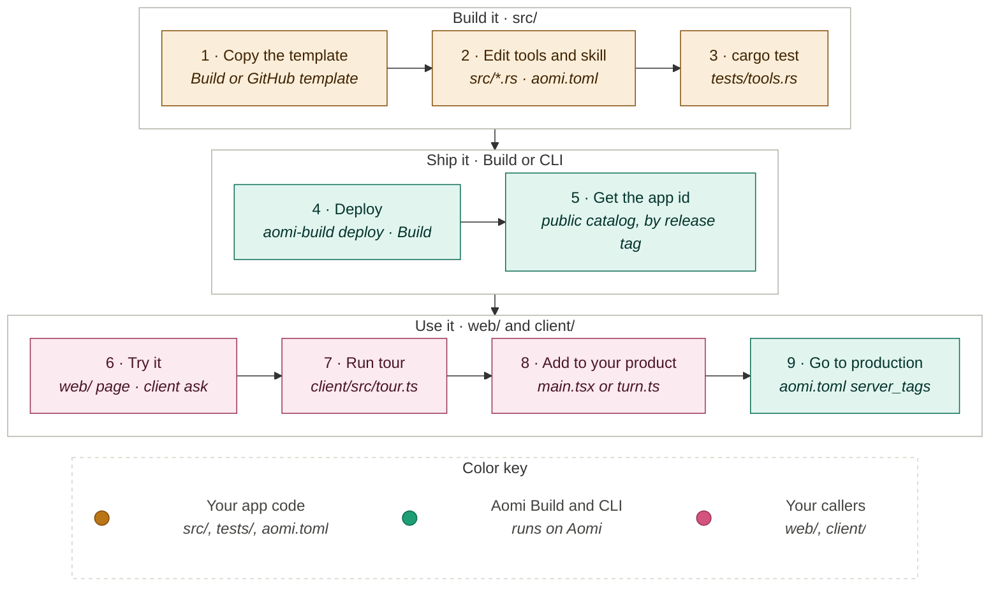
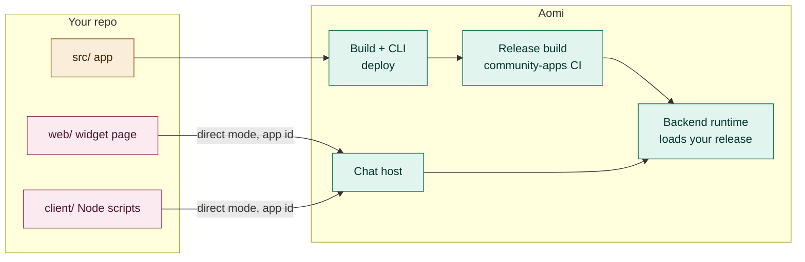

# Aomi app template

You came to Aomi to build an app. This repo is a working app you can deploy in a
few minutes, then turn into your own. Start with the journey below. The code
and the architecture come after it.

## Your journey

| Step | What you do | Where |
| --- | --- | --- |
| 1 | Get your own copy. Never connect this template repo itself as a Project. | [Get your copy](#1-get-your-own-copy) |
| 2 | Rename the app and change the tools. | [The app](#the-app-src) |
| 3 | Run the tests. | [Test locally](#3-test-locally) |
| 4 | Deploy from Build or the CLI. | [Deploy](#4-deploy) |
| 5 | Look up the application id. | [Application id](#5-get-the-application-id) |
| 6 | Chat with your app from the widget page or one `ask` call. | [Try it](#6-try-it) |
| 7 | Run `tour`, which checks every tool on the deployed app. | [Check the deploy](#7-check-the-whole-deploy) |
| 8 | Copy one caller file into your product. | [Put it in your product](#8-put-it-in-your-product) |
| 9 | Allow production servers to load your release. | [Go to production](#9-go-to-production) |

After step 7, you loop: change a tool, bump `BUILD`, deploy, run `tour` again.



## The steps

### 1. Get your own copy

Pick one:

- **Build.** Open [build.aomi.dev](https://build.aomi.dev) and choose "Start
  from the template". Build creates your repo and the Project for you.
- **GitHub.** Click "Use this template" on this repo and clone your copy. You
  create the Project in step 4.

### 2. Make it yours

Rename the app in two places. They must match:

- `name` in `dyn_aomi_app!` in `src/lib.rs`
- `name` in `aomi.toml`

Then change the tools. [The app](#the-app-src) section explains each file.

### 3. Test locally

```sh
cargo test --locked
pnpm install
pnpm -r typecheck
```

CI runs the same checks in `.github/workflows/check.yml`. A local run with
`aomi-run` shows the model every tool at once. Skill gating only happens on
Aomi's servers, so test skills after you deploy.

### 4. Deploy

**From Build:** press Deploy on your Project.

**From the CLI:** install it once. Version 6.0.2 or later is required.

```sh
cargo install aomi-sdk --version 6.0.2 --features cli --locked
```

Run these from your clone. Skip `project create` if Build already made the
Project.

```sh
aomi-build login --backend https://api.aomi.dev
aomi-build project create
aomi-build deploy
```

- `login` opens GitHub in your browser to sign you in. It saves the backend
  URL, so later commands reuse it.
- `project create` prints a GitHub authorization page for your repo. Approve it
  within 10 minutes as a GitHub user with admin on the repo. The Project is
  created when you approve. Flags: `--repo owner/name`, `--platform <name>`
  (default `community`), `--build-url <url>`, `--no-browser`.
- `deploy` checks that your tree is clean and pushed and that the SDK pin
  matches. Then it builds, activates and checks the app, and prints the
  release tag.

For staging, use [build-staging.aomi.dev](https://build-staging.aomi.dev) and
`--backend https://api-staging.aomi.dev`.

### 5. Get the application id

The callers reach your app by its application id. The CLI does not print it
yet. Look it up in the public catalog with the release tag from step 4:

```sh
curl -s "https://chat-staging.aomi.dev/api/public/catalog/apps?platform=community" \
  | jq '.[] | select(.app_release_tag == "<your release tag>")'
```

Use `https://chat.aomi.dev` for production. A redeploy keeps the same
application id, and the catalog row moves to the new release tag. The lookup
only works while `public = true` in `aomi.toml`.

### 6. Try it

Both callers use the production chat host by default and print the host when
they start. For staging, set the base URL line in the `.env` file to
`https://chat-staging.aomi.dev`.

Widget page:

```sh
cp web/.env.example web/.env      # set VITE_AOMI_APPLICATION_ID
pnpm install
pnpm --filter web dev             # open http://localhost:5173
```

A guest chat lives only in the open page. Reloading the page starts a new,
empty chat, and the earlier guest thread is not restored.

One prompt from Node:

```sh
cp client/.env.example client/.env      # set AOMI_APPLICATION_ID
pnpm --filter client ask "Greet Ada, excitedly"
```

### 7. Check the whole deploy

```sh
pnpm --filter client tour
```

`tour` runs three sessions. Each checks something you can only see on a
deployed app:

| Session | Prompts | What it shows |
| --- | --- | --- |
| 1 | "Which build are you?", "Greet Ada, excitedly", the price of two Nebula Lattes and a Moon Mochi | `about` returns your `BUILD`. `greet` runs with `excited: true`. The model activates the café skill, then calls `menu_search` and `order_total` (1180 cents, $11.80). |
| 2 | "Greet Bob" | A new session starts with the skill off. Only `greet` runs. |
| 3 | "Order 50 Comet Croissants", "add item C-99" | Tool errors come back as plain messages, and the next turn still works. |

When you change the tools, change the prompts in `client/src/tour.ts` to match.

### 8. Put it in your product

Copy the caller that fits your product:

- A website: `web/src/main.tsx`. It renders `<AomiWidget>` in direct mode for
  your application id.
- A backend or script: `client/src/turn.ts`. It sends a prompt in direct mode
  and reads the tools that ran and the reply.

Keep direct mode. It sends every message to your app. Without it, the Auto
agent answers.

### 9. Go to production

`aomi.toml` leaves `server_tags` unset, which means only staging servers load
your release. Set `server_tags = ["prod"]` once your app works on staging, then
deploy against `https://api.aomi.dev`.

## Architecture

Your repo holds two kinds of code. The app runs on Aomi. The callers run
wherever you put them and reach the app over the network.



- **Deploy path.** `aomi-build deploy` or the Build button sends your commit to
  Aomi. Aomi builds the Rust code into a release, activates it and checks that
  the runtime loads it.
- **Chat path.** A caller signs in as a guest and sends a chat turn in direct
  mode to your application id. The backend checks your Builder credit, runs the
  model with your preamble and tools, and streams back tool events and the
  reply.
- **Hosting.** Each active app costs Builder credit every month. If your
  balance goes below zero, chats to your apps return `402 builder_debt`.

## The code

| Path | Half | What it is |
| --- | --- | --- |
| `src/lib.rs` | App | Entry point. Declares the name, the preamble, the tools and the skill. |
| `src/tools.rs` | App | `greet` and `about`. The model always sees these. |
| `src/cafe.rs`, `src/menu.json` | App | `menu_search` and `order_total`, plus their menu data. |
| `src/skill/cafe.md` | App | Instructions the model gets when it activates the café skill. |
| `tests/tools.rs` | App | Tests every tool, the manifest, and which skill owns each tool. |
| `aomi.toml` | Config | App name, display name, catalog visibility, server tags. |
| `.aomi/config.json` | Config | Tells Build which `aomi.toml` files to deploy. |
| `web/src/main.tsx` | Caller | A React page with `<AomiWidget>` in direct mode. |
| `client/src/turn.ts` | Caller | Creates the client, sends a prompt in direct mode, prints tools and reply. |
| `client/src/run.ts` | Caller | `ask`: one prompt, then exit. |
| `client/src/tour.ts` | Caller | `tour`: the scripted three-session check. |

### The app (`src/`)

`dyn_aomi_app!` in `src/lib.rs` is the whole contract with Aomi. It names the
app, gives the model its preamble, and lists the tools and skills.

- **Always-on tools** go in `tools = [...]`. Here that is `greet` and `about`.
- **Skill tools** go inside a skill. The `playground-example/cafe` skill owns
  `menu_search` and `order_total`. The model sees them only after it activates
  the skill. Use skills to keep the model's tool list short until it needs a
  group of tools.
- **Each tool** is a type that implements `DynAomiTool`, with a description, an
  argument struct and a `run` function. Copy `Greet` in `src/tools.rs` to start
  a new one.
- **`BUILD`** in `src/lib.rs` is what `about` reports. Bump it on every change
  so you can tell which build answered.

Keep the `aomi-sdk = "=7.0.0"` pin in `Cargo.toml`. It must match the backend
runtime exactly. The deploy preflight rejects any other version. The Rust build
never touches the JS workspace.

### The callers (`web/`, `client/`)

Both are small examples on top of the published packages, `@aomi-labs/widget`
and `@aomi-labs/client`. You don't need them to run your app. They show the code
your product needs to reach it.

## When something fails

| You see | What it means | What to do |
| --- | --- | --- |
| Preflight rejects the SDK version | `Cargo.toml` doesn't pin `aomi-sdk = "=7.0.0"` | Restore the exact pin |
| `402 builder_debt` | Your Builder credit balance is below zero. Every chat to your apps stops, guests included. | Add credit in Build |
| `429` on guest sign-in | The chat host limits guest sign-ins per IP | Wait for the `retry-after` time, then rerun |
| `403 forbidden` from the client | The application id is wrong or not yours | Look the id up again in the catalog |
| Replies come from the Auto agent | The caller isn't in direct mode | Keep the `direct` target in `turn.ts` and `main.tsx` |
| The café tools never run | The skill wasn't activated, or you are testing locally | Test on a deployed app and ask about the menu |
